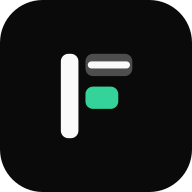
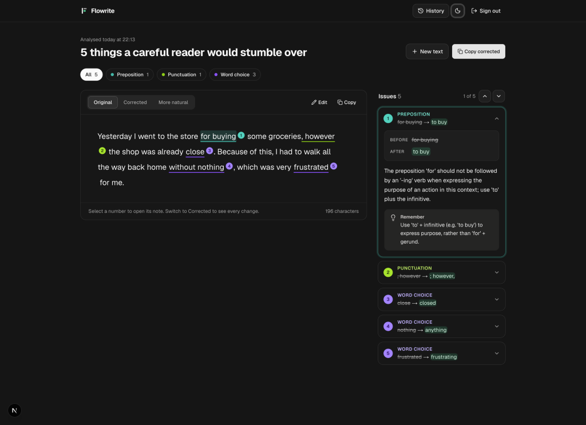
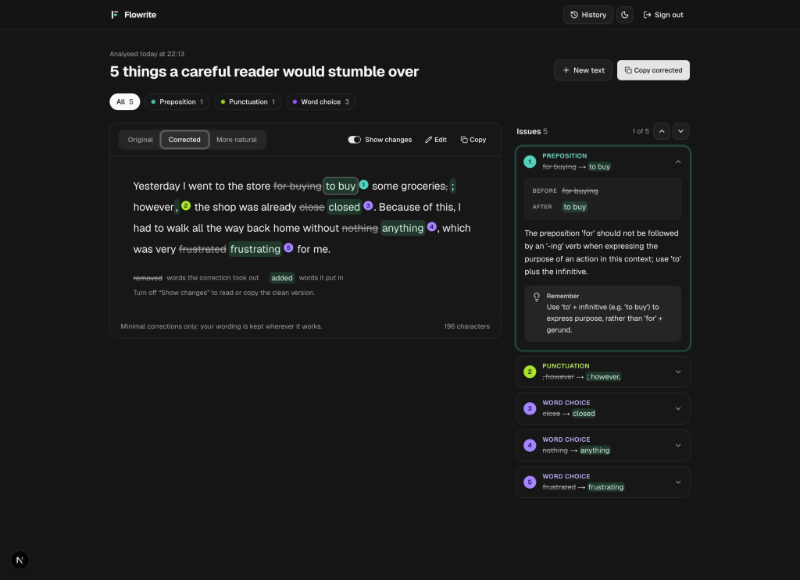

<div align="center">



# Flowrite

**An AI writing coach for English.**  
Paste a sentence or short paragraph and get categorised, inline-highlighted feedback, a word-level diff, and two rewrites you can learn from.

[](https://github.com/musayann/flowrite/actions/workflows/ci.yml)
[](LICENSE)
[](https://nextjs.org/)
[](https://www.typescriptlang.org/)
[](CONTRIBUTING.md)

[Why Flowrite?](#why-flowrite) · [Features](#features) · [Quick Start](#quick-start) · [Configuration](#configuration) · [How It Works](#how-it-works) · [Contributing](#contributing) · [License](#license)

<br />



*Dark mode — **Original** tab with inline highlights, category filter chips, and margin notes.*

</div>

---

## Why Flowrite?

Most grammar tools quietly rewrite your text without teaching you *why* something sounded awkward.

**Flowrite** is built for people who want to write clearer, more natural **English**:

- **Learn the rule, not just the fix** — every flagged issue includes an excerpt, a clear explanation, a reusable rule you can apply next time, and a focused before/after diff.
- **Keep your keys & data under your control** — self-hosted with Auth.js v5 single-user login, server-side-only provider keys, no database, and browser-local history.
- **Swap AI providers freely** — run OpenAI, Google Gemini, or Anthropic Claude through a single allowlisted interface without rebuilding.

---

## Features

| Capability | What you get |
| --- | --- |
| **English Writing Coach** | Clear, consistent English across the interface, explanations, and both rewrites. |
| **9 Issue Categories** | `coherence`, `information-flow`, `structure`, `word-choice`, `connector`, `article`, `preposition`, `punctuation`, and `clarity`. |
| **Inline Highlights** | Colour-coded underlines and numbered markers directly in your text, paired with sticky margin notes on desktop, a bottom sheet on mobile, category filter chips, and prev/next stepping. |
| **Word-Level Diff** | Toggle **Show changes** in the *Corrected* tab to see removed words struck through and added words highlighted, linked back to the corresponding issue. |
| **Two Rewrites** | **Corrected** (minimal, targeted fixes) and **More natural** (idiomatic rephrasing with an editorial note), each with one-click copy. |
| **Multi-Provider AI** | Supports OpenAI, Google Gemini, and Anthropic Claude—configurable per deployment via `MODEL` or per request against a strict server allowlist. |
| **Local History** | Your last **20** analyses are saved locally in `localStorage` (`flowrite:history`) via the history drawer—no database required. |
| **Dark / Light Mode & Shortcuts** | System-aware theme toggle, `Cmd/Ctrl + Enter` to analyse drafts (up to 1,500 characters), and `Escape` to close the mobile issue sheet. |

<br />

<div align="center">



*Dark mode — **Corrected** tab with word-level inline diff (**Show changes**) enabled.*

</div>

---

## Quick Start

### Prerequisites

- **Node.js 20+** (CI runs on Node 22) and **npm**
- An API key for at least one provider (**OpenAI**, **Google Gemini**, or **Anthropic**)
- *(Optional)* A [Langfuse](https://langfuse.com/) project and API keys for OpenTelemetry tracing

### Setup

```bash
# 1. Install dependencies
npm install

# 2. Copy the environment template
cp env.local.example .env.local

# 3. Generate an Auth.js secret and fill in .env.local (see Configuration below)
npx auth secret
```

### Run

```bash
npm run dev
```

Open [http://localhost:3000](http://localhost:3000) and sign in with the `AUTH_USERNAME` and `AUTH_PASSWORD` you configured in `.env.local`.

---

## Configuration

### Environment variables

Configure these in `.env.local` (see [`env.local.example`](env.local.example) for the full template):

| Variable | Purpose |
| --- | --- |
| `MODEL` | Active model as `provider:model`. Defaults to `openai:gpt-4o`. |
| `OPENAI_API_KEY` | OpenAI API key (server-side only). |
| `GEMINI_API_KEY` | Google Gemini API key. Required for `google:` models. |
| `ANTHROPIC_API_KEY` | Anthropic API key. Required for `anthropic:` models. |
| `OPENAI_MODEL` | Legacy bare OpenAI model ID used only when `MODEL` is unset. |
| `AUTH_SECRET` | Session signing key. Generate with `npx auth secret`. |
| `AUTH_USERNAME` | Single-user login username. |
| `AUTH_PASSWORD` | Single-user login password. |
| `AUTH_TRUST_HOST` | Set to `true` for self-hosted / non-Vercel deployments. |
| `LANGFUSE_PUBLIC_KEY` | *(Optional)* Langfuse public key. Tracing starts when both keys are set. |
| `LANGFUSE_SECRET_KEY` | *(Optional)* Langfuse secret key (server-side only). |
| `LANGFUSE_BASE_URL` | *(Optional)* Langfuse host URL (defaults to `https://cloud.langfuse.com`). |
| `LANGFUSE_TRACING_ENVIRONMENT` | *(Optional)* Environment label (e.g. `development`, `production`). |
| `LANGFUSE_RELEASE` | *(Optional)* Release/version tag attached to traces. |
| `LANGFUSE_TRACING_ENABLED` | *(Optional)* Set to `false` to disable exporting traces. |

### Model allowlist

Set `MODEL` to any of the allowlisted IDs in [`lib/models.ts`](lib/models.ts):

| `MODEL` | Provider |
| --- | --- |
| `openai:gpt-4o` *(default)* | OpenAI |
| `openai:gpt-5-mini` | OpenAI |
| `google:gemini-3.8-flash` | Google |
| `google:gemini-3.7-flash` | Google |
| `google:gemini-3.5-flash-lite` | Google |
| `anthropic:claude-sonnet-5` | Anthropic |
| `anthropic:claude-haiku-4-5-20251001` | Anthropic |

`MODEL` is read fresh on every request, so changing it does not require a rebuild. You can also pass a `model` field alongside `text` in `POST /api/analyze`; it is validated against the same `Map` allowlist so arbitrary models cannot be billed against your API keys.

Adding a new model from a supported provider is a single entry in `CATALOGUE` inside [`lib/models.ts`](lib/models.ts).

---

## How It Works

```text
Client (Compose / Review UI)
   │  POST /api/analyze  { text, model? }
   ▼
app/api/analyze/route.ts
   ├─ Auth.js v5 session check + rate limiting + Zod input validation (≤ 1,500 chars)
   ├─ Model resolution against allowlist (lib/models.ts)
   ▼
lib/analysis.ts
   ├─ OpenAI & Google  ──▶ Structured Outputs (response_format: json_schema)
   └─ Anthropic        ──▶ Forced tool_call + server-side Zod validation
   ▼
JSON Result (issues[] + corrected + natural + naturalNote)
   └─ Optional Langfuse OpenTelemetry trace (writing-analysis)
```

- **Unified SDK, strict schemas:** All three providers use the OpenAI SDK pointed at each provider's OpenAI-compatible `baseURL`, backed by shared Zod schemas in [`lib/schema.ts`](lib/schema.ts).
- **Stateless & private:** API keys never leave the server, no user text is stored in a database, and review history stays in the browser's `localStorage`.

### Tech stack

- **Framework:** Next.js 16 (App Router) · React 19 · TypeScript 6
- **Styling & UI:** Tailwind CSS v4 · shadcn/ui (Radix UI) · Lucide icons · `next-themes`
- **Auth & AI:** Auth.js v5 (`next-auth`) · OpenAI SDK · Zod · Langfuse OpenTelemetry (optional)
- **Testing:** Vitest · Testing Library · V8 coverage (75% thresholds)

### Scripts

| Command | Description |
| --- | --- |
| `npm run dev` | Start the Next.js development server. |
| `npm run build` | Build the application for production. |
| `npm run start` | Start the production server. |
| `npm run lint` | Run ESLint. |
| `npm run typecheck` | Run TypeScript type checking (`tsc --noEmit`). |
| `npm run test` | Run Vitest in watch mode. |
| `npm run test:run` | Run the full test suite once. |
| `npm run test:coverage` | Run tests with V8 coverage enforcement. |

### Project structure

```text
app/
  api/analyze/route.ts   # Analysis endpoint (auth, rate limit, validation, tracing)
  login/                 # Single-user login page
  reviews/[id]/          # Dedicated review view
  page.tsx               # Compose screen
components/              # ComposeView, ReviewView, AnalyzeForm, HighlightedText, ChangesText, IssueMargin, IssueSheet, HistoryDrawer, ...
lib/
  schema.ts              # Zod schemas & 9 issue categories
  prompt.ts              # System prompt for the English writing coach
  models.ts              # Provider registry & model allowlist
  analysis.ts            # Structured Outputs / forced tool-call execution
  openai.ts              # Per-provider clients wrapped with Langfuse tracing
  diff.ts / highlight.ts # Word-level diffing & inline highlight mapping
  history.ts             # Browser localStorage history (up to 20 entries)
tests/                   # 35 Vitest unit & component test files
auth.ts                  # Auth.js v5 configuration
instrumentation.ts       # Next.js OpenTelemetry instrumentation entry
```

---

## Contributing

Contributions of all sizes are warmly welcome! Here are a few great places to start:

- **Add or update AI models** in [`lib/models.ts`](lib/models.ts) for supported OpenAI-compatible providers.
- **Refine prompts & categories** in [`lib/prompt.ts`](lib/prompt.ts) and [`lib/categories.ts`](lib/categories.ts) to sharpen feedback.
- **Polish UI/UX & accessibility** across the compose, margin-note, mobile sheet, and diff views.
- **Expand tests** under `tests/` to keep coverage healthy across `node` and `dom` environments.
- **Improve documentation** for self-hosting, configuration, and onboarding.

Please read our community guides before getting started:

- [**Contributing Guide**](CONTRIBUTING.md) — local setup, code quality, testing, and PR workflow
- [**Code of Conduct**](CODE_OF_CONDUCT.md) — community standards we all uphold
- [**Security Policy**](SECURITY.md) — how to report vulnerabilities privately
- [**Open Issues**](https://github.com/musayann/flowrite/issues) · [**Pull Requests**](https://github.com/musayann/flowrite/pulls)

---

## License

Flowrite is open-source software licensed under the [MIT License](LICENSE).
